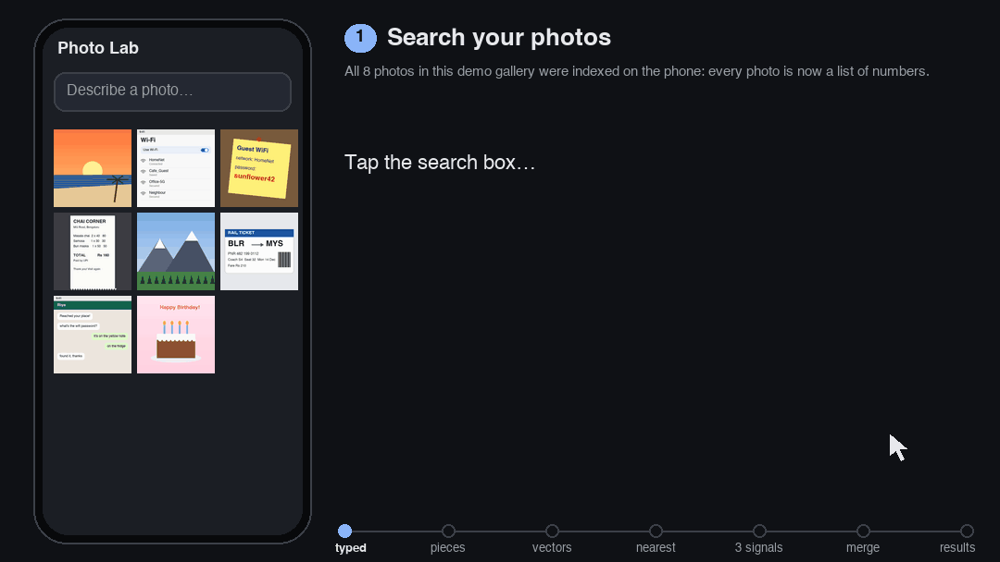
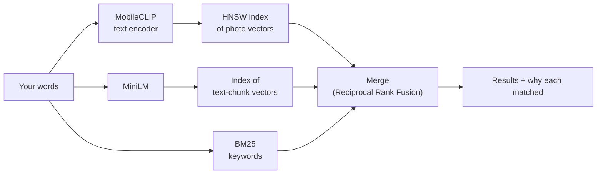
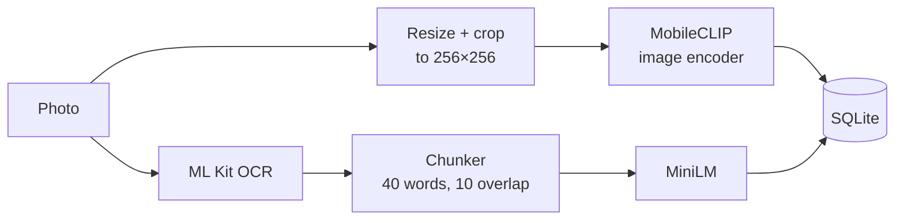

# Photo Lab

**Search the photos on your Android phone by describing them, fully offline.**

Type *"beach at sunset"*, *"wifi password"* or *"INV-2291"* and the matching photos come up in about 40 ms. Nothing is uploaded: every neural network runs on the phone.



*One real search on a small drawn demo gallery: every number in the animation comes from the same models the app uses ([how it's made](scripts/journey-gif)).*

The project is also meant to be learned from. The AI parts most apps hide inside a library are written out in plain Kotlin here: tokenizers, a transformer, a vector index, keyword search, a training loop. Each one is tested against the official Python implementation.

---

## What it does

| You type | What finds it | How |
|---|---|---|
| "beach at sunset" | **What the photo looks like** | MobileCLIP turns both the photo and your words into 512 numbers; similar meaning → similar numbers |
| "wifi password" | **What the text in the photo means** | ML Kit reads the text, it is cut into small chunks, MiniLM turns each chunk into 384 numbers |
| "INV-2291" | **Exact words in the photo** | BM25 keyword search, the classic search-engine formula |

The three result lists are merged into one. Each result shows *why* it matched.

**Personal labels.** Tag 5 photos as "my dog" and the phone trains a small model in about 0.1 s that finds the rest.

**No guessing.** If nothing really matches (e.g. "a dog" in a gallery with no dogs), the app says *"No strong match"* instead of showing random photos.

## How a search works



And once per photo, in the background:



## Results

**Accuracy** — 1,000 COCO test photos, searched with 5,000 human-written captions ([details](results/m1-benchmark.md)):

| | Right photo is #1 | In top 5 | In top 10 |
|---|---|---|---|
| MobileCLIP-S0 through our Kotlin pipeline | 61.6% | 87.2% | 94.4% |

**Speed** — Motorola Edge 60 Stylus, a mid-range phone (Snapdragon 7s Gen 2) ([details](results/m1-phone.md)):

| | Time |
|---|---|
| Understand one photo (CLIP) | 128 ms |
| Read the text in one photo (OCR + MiniLM) | ~112 ms |
| One search, end to end | 30–50 ms |
| Train a personal label | 109 ms |

A 5,000-photo gallery is indexed once in about 20 minutes. After that only new photos are processed.

**Things we found by measuring**
- The ready-made uint8 (8-bit) CLIP models on Hugging Face are **broken**: 0.1% accuracy, the same as random. Our own 8-bit text model gives the same accuracy as full precision and is 39 MB smaller.
- The HNSW index finds 99–100% of what a slow full scan finds.
- Personal labels only beat plain search from about 5 tagged photos, so the app waits for 5 before training.
- Nearest-neighbour search always returns *something*. Without a relevance check, "update" showed a Wi-Fi screenshot as the best match. See [results/m1-phone.md](results/m1-phone.md) for the bugs only a real phone revealed.

## Try it

You need an arm64 Android phone (Android 10+) and, to build, JDK 21+. Android Studio's bundled JDK works:

```bash
export JAVA_HOME="$HOME/Applications/Android Studio.app/Contents/jbr/Contents/Home"
```

**Option A — just the app.** Build and install the APK; on first launch it offers to download the models (~400 MB) from Hugging Face.

```bash
./gradlew :photos-app:installDebug
```

**Option B — models over USB** (faster, and uses our smaller 8-bit text model). Download the files listed in [`Models.kt`](photos-app/src/main/kotlin/dev/spikeai/photos/data/Models.kt) into `.work/models/mobileclip` and `.work/models/minilm`, make the 8-bit model, then install:

```bash
python scripts/quantize-text-model.py .work/models/mobileclip/text_model.onnx
```

```bash
scripts/install-phone.sh
```

**Run the tests** (they compare our Kotlin against Python reference outputs and need the model files in `.work/models`):

```bash
./gradlew :embed-core:test :search-core:test
```

## Inside the app: a learning tool

- **Search** — type, see results, tap a photo to see why it matched and the text found in it.
- **How did this search work?** — replays your search as 7 animated steps with the real numbers: the word pieces and their ids, the two vectors as barcodes, the HNSW graph hops, each signal's scores against its bar, the fusion sum, and the results.
- **See inside this photo** — the 256×256 square the network actually saw, its 512 numbers, what CLIP thinks it is, the text OCR read, how that text was cut into overlapping chunks, and where the photo sits in the index.
- **Lab knobs** — every number the app uses is a slider or switch with a one-line explanation:
  - search: signals on/off, the other-guesses check, thresholds, fusion k, BM25 k1/b, HNSW ef. A live preview re-runs a search and says what moved.
  - index: HNSW links and build effort, chunk size and overlap, then Rebuild.
  - training: epochs, learning rate, L2 pull, minimum tags.
- **Labels → ▶ Watch it train** — the loss curve draws itself while the top photos re-order, pass by pass, as the one-layer model learns from your tags.
- **Lab** also measures HNSW accuracy on your own photos and compares our hand-written MiniLM with ONNX Runtime on any two phrases.

## Where things live

| Folder | What's inside |
|---|---|
| [`embed-core/`](embed-core) | Turning text and images into vectors: WordPiece and CLIP tokenizers, MiniLM (via ONNX Runtime **and** a hand-written forward pass), image resize/crop, CLIP encoder |
| [`search-core/`](search-core) | Finding vectors and words: brute-force index, HNSW, BM25, rank fusion, chunker, the label trainer. No dependencies. |
| [`photos-app/`](photos-app) | The Android app: indexer, SQLite store, hybrid search, labels, Lab screen |
| [`bench/`](bench) | The COCO benchmark that produces `results/m1-benchmark.md` |
| [`results/`](results) | Measured numbers, laptop and phone |
| [`scripts/journey-gif/`](scripts/journey-gif) | Draws the demo gallery and renders the animation above with the real models |
| [`spikes/`](spikes), [`guard-core/`](guard-core), [`fixtures-shop/`](fixtures-shop), [`docs/`](docs) | Earlier experiments that led here (an on-phone screen agent, a build-time UI checker) |

A good reading order: `WordPieceTokenizer.kt` → `Embedder.kt` → `VectorMath.kt` → `MiniLmKotlin.kt` → `Hnsw.kt` → `Bm25.kt` → `SearchEngine.kt`.

## FAQ

**Does it learn as I use it?** Not by itself. The three networks are pre-trained and frozen. The only on-phone training is personal labels, which you start by tagging photos.

**Why three signals instead of just CLIP?** CLIP understands what a photo *looks like* but barely reads text in it. Screenshots, receipts and notes are mostly text, so OCR + MiniLM (meaning) and BM25 (exact words) cover what CLIP misses.

**Why write a transformer by hand when ONNX Runtime exists?** To learn. The app uses ONNX Runtime (~10 ms) for real searches. The hand-written version (~150 ms) produces the same numbers and is there to read and step through.

**Does it need the internet?** Only once, to download the models. Search, indexing and training are offline.

## Privacy

Photos, the text read from them and their vectors stay on the phone. The network is used only to download models. Google's ML Kit library may send anonymous usage statistics of its own.

## Credits and licences

The code in this repo is under the [MIT licence](LICENSE). Model weights are not in this repo and come with their own licences:
- [MobileCLIP](https://github.com/apple/ml-mobileclip) by Apple — Apple ML research licence (ONNX export by [Xenova](https://huggingface.co/Xenova/mobileclip_s0))
- [all-MiniLM-L6-v2](https://huggingface.co/sentence-transformers/all-MiniLM-L6-v2) — Apache-2.0
- [ML Kit text recognition](https://developers.google.com/ml-kit/vision/text-recognition/v2) by Google
- [ONNX Runtime](https://onnxruntime.ai) by Microsoft — MIT
- Benchmark photos from [COCO](https://cocodataset.org) (not included)

Plan and history: [PLAN.md](PLAN.md) · Learning notes: [LEARNING.md](LEARNING.md)
